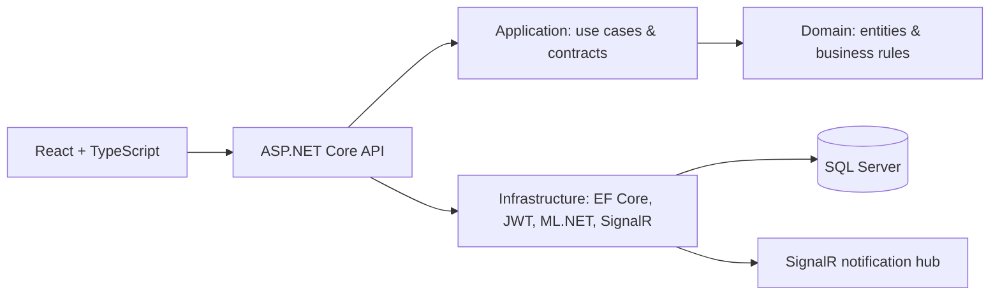

# SmartDesk — AI-Augmented IT Service Desk

SmartDesk is a full-stack IT service desk that uses AI to reduce repetitive ticket-triage work while keeping support agents in control. Customers submit incidents and requests; SmartDesk classifies them, applies SLA rules, routes work to the right queue, maintains an auditable history, and keeps stakeholders updated in real time.

> This is a portfolio project designed to demonstrate production-minded .NET engineering: Clean Architecture, secure APIs, RBAC, real-time messaging, SLA automation, and confidence-aware ML integration.

## Why SmartDesk?

IT teams often spend valuable time manually reading, categorizing, prioritizing, and routing incoming support requests. SmartDesk treats AI as an automation layer inside the actual service-desk lifecycle—not as a chatbot bolted onto a CRUD application.

```text
Customer ticket → AI classification → confidence check → SLA selection
                → routing / assignment → live notification → audit trail
```

When the classifier is uncertain or unavailable, the ticket is still created and remains reviewable by an agent. That makes the workflow resilient and keeps people accountable for final operational decisions.

## Highlights

- Clean Architecture modular monolith with clear API, Application, Domain, and Infrastructure boundaries.
- JWT authentication with BCrypt password hashing and Customer, Agent, and Admin RBAC.
- Role-scoped ticket workflows: creation, searching, filtering, pagination, assignment, comments, timeline, and state-machine transitions.
- ML.NET-based classification of ticket category and priority from a synthetic 336-example training dataset.
- Confidence-aware automation: predictions are applied at ≥60%; anything below 80% is visibly flagged for review.
- Configurable SLA policies with first-response and resolution deadlines, at-risk/breach tracking, and a hosted monitoring service.
- SignalR real-time notifications with durable notification-inbox fallback for offline users.
- React + TypeScript interface with dashboards, ticket detail views, activity history, AI transparency, and responsive layout.
- Swagger/OpenAPI, health endpoints, structured Serilog logging, consistent API error handling, EF Core migrations, and automated tests.

## Technology

| Area | Technology |
| --- | --- |
| Backend | C#, .NET 8, ASP.NET Core Web API |
| Architecture | Clean Architecture, SOLID-oriented modular monolith |
| Data | Entity Framework Core, SQL Server migrations |
| Security | JWT Bearer authentication, BCrypt, role-based authorization |
| AI | ML.NET, SDCA multiclass classification |
| Real time | ASP.NET Core SignalR |
| Frontend | React, TypeScript, Vite, Axios, Recharts |
| Quality | xUnit, EF Core InMemory tests |
| Observability | Serilog, Swagger/OpenAPI, health checks |

## Architecture



The dependency direction is intentional: Domain has no framework dependencies; Application defines use-case contracts; Infrastructure implements external concerns; API stays focused on HTTP delivery, authentication, and composition.

More detail: [architecture](docs/architecture.md) · [API guide](docs/api.md) · [SLA design](docs/sla.md) · [AI classification](docs/ai-classification.md) · [real-time notifications](docs/realtime-notifications.md).

## Core workflow

1. A Customer creates a support ticket.
2. ML.NET predicts a category, priority, and confidence score.
3. SmartDesk applies the prediction only when it meets the configured confidence threshold; low-confidence results are retained for agent review.
4. The applicable SLA policy calculates first-response and resolution deadlines.
5. Agents claim or are assigned tickets, update status, and communicate with the customer.
6. Every important action is recorded in the ticket timeline.
7. SignalR sends durable, user-scoped notifications for assignments, comments, status updates, and SLA events.

## Roles and access

| Role | Capabilities |
| --- | --- |
| Customer | Register, create tickets, view only their own tickets, and add public comments. |
| Agent | View assigned/unassigned queue, claim tickets, manage valid ticket states, and add internal or public comments. |
| Admin | View all tickets, assign active agents, and receive SLA-breach notifications. |

## Ticket lifecycle

```text
New → Open → In Progress → Waiting for Customer → In Progress → Resolved → Closed
                                                    ↘                 ↗
                                                     Reopened ────────
```

Invalid transitions are rejected centrally rather than relying on client-side behavior.

## AI transparency and safety

The initial ML model is trained from synthetic examples and is a functional demonstration—not a claim of production accuracy. SmartDesk explicitly exposes its prediction, confidence, and review state in API responses and the UI.

- **≥ 80% confidence:** prediction is auto-applied and treated as high-confidence.
- **60–79% confidence:** prediction is applied but flagged for agent review.
- **< 60% confidence:** prediction is saved for visibility but is not auto-applied.
- **Classifier failure:** ticket creation continues; an audit event records the issue.

## Run locally

### Prerequisites

- .NET 8 SDK
- Node.js 20+ and npm
- SQL Server (LocalDB, Docker, or another local instance)

### 1. Configure API secrets

Do not commit these values. Set them only in your local environment or secret store.

```powershell
$env:ConnectionStrings__SmartDesk = "Server=localhost,1433;Database=SmartDesk;User Id=sa;Password=<your-password>;TrustServerCertificate=True"
$env:Jwt__SigningKey = "replace-with-a-random-secret-of-at-least-32-characters"
$env:Seed__DefaultPassword = "development-only-password"
```

### 2. Start the API

```powershell
dotnet tool restore
dotnet ef database update --project src/SmartDesk.Infrastructure --startup-project src/SmartDesk.API
dotnet run --project src/SmartDesk.API
```

- API: `http://localhost:5160`
- Swagger: `http://localhost:5160/swagger`
- Health: `http://localhost:5160/health`
- Readiness: `http://localhost:5160/health/ready`

In Development, the app seeds categories, SLA policies, and the following users when `Seed__DefaultPassword` is configured:

| Role | Email | Password |
| --- | --- | --- |
| Admin | `admin@smartdesk.local` | Value of `Seed__DefaultPassword` |
| Agent | `agent@smartdesk.local` | Value of `Seed__DefaultPassword` |
| Customer | `customer@smartdesk.local` | Value of `Seed__DefaultPassword` |

### 3. Start the frontend

```powershell
cd frontend/smartdesk-web
Copy-Item .env.example .env
npm install
npm run dev
```

Open `http://localhost:5173`. Set `VITE_API_URL` in `.env` if the API is hosted elsewhere.

## Testing and verification

```powershell
dotnet build SmartDesk.sln -warnaserror
dotnet test SmartDesk.sln

cd frontend/smartdesk-web
npm run build
```

The test suite covers authentication behavior, authorization boundaries, ticket creation, valid/invalid transitions, SLA calculation, notification state, and baseline classifier outcomes.

## API quick reference

| Endpoint | Purpose |
| --- | --- |
| `POST /api/auth/register` | Register a Customer account. |
| `POST /api/auth/login` | Authenticate and receive a JWT. |
| `GET /api/tickets` | Role-scoped tickets with pagination and filters. |
| `POST /api/tickets` | Create a Customer ticket. |
| `PUT /api/tickets/{id}/assign` | Claim or assign a ticket. |
| `PUT /api/tickets/{id}/status` | Change ticket status through a valid transition. |
| `POST /api/tickets/{id}/comments` | Add a public/internal ticket comment. |
| `GET /api/notifications` | Read the durable notification inbox. |
| `PUT /api/notifications/{id}/read` | Mark a notification as read. |
| `/hubs/notifications` | JWT-protected SignalR hub. |

Use Swagger’s **Authorize** button with the token returned from login to explore protected endpoints.

## Project structure

```text
src/
  SmartDesk.API/            HTTP API, middleware, Swagger, SignalR
  SmartDesk.Application/    Use-case contracts, DTOs, abstractions
  SmartDesk.Domain/         Entities, enums, lifecycle rules
  SmartDesk.Infrastructure/ EF Core, JWT, ML.NET, SLA monitor, notifications
tests/
  SmartDesk.UnitTests/      Domain/application/infrastructure-focused unit tests
  SmartDesk.IntegrationTests/ API-oriented integration-test project
frontend/smartdesk-web/     React + TypeScript client
docs/                       Architecture and implementation notes
```

## Roadmap

- Expand API integration and authorization test coverage.
- Add Docker Compose for the API, frontend, and SQL Server.
- Add GitHub Actions build/test workflow.
- Add admin management screens, analytics, attachments, and configurable SLA/category management.
- Replace the synthetic ML baseline with versioned production training data and a human-feedback loop.
- Prepare Azure App Service, Azure SQL, Static Web Apps, and Application Insights deployment guidance.

## Resume-ready description

> Built **SmartDesk**, an AI-augmented IT service desk using ASP.NET Core, Clean Architecture, EF Core, SQL Server, React, and TypeScript. Implemented JWT/RBAC, ML.NET confidence-aware ticket classification, SLA automation with background monitoring, SignalR notifications, auditable ticket workflows, and automated tests.

---

This repository intentionally prioritizes correctness, security, maintainability, and transparent automation over inflated claims or unnecessary infrastructure complexity.
